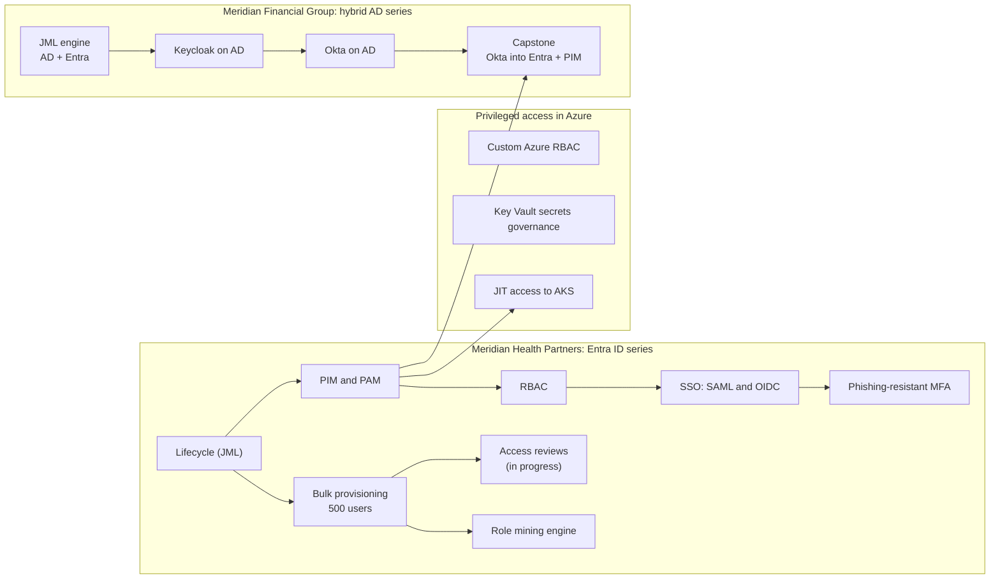

# Isaiah "Zay" Herard

### Identity and Privileged Access Engineering

I build identity systems in live tenants, break them on purpose, and write down exactly what happened.

---

## Start here

If you only open one repo, open the capstone.

### [Meridian Identity Fabric: Okta + Entra ID Federation with JIT Privileged Access](https://github.com/ZayLinux26/meridian-okta-entra-identity-fabric)

Active Directory is the source of truth, Okta is the identity provider, and Entra ID is the service provider. Users flow from AD to Okta to Entra, sign in to Microsoft through Okta over SAML 2.0 with a phishing-resistant factor, and get admin rights in Entra only through a just-in-time PIM activation tied to a ticket.

| What I tested | Result |
|---|---|
| Leaver | One AD disable. Okta deactivated the user, and Entra disabled the account **about 10 seconds** after Okta did. |
| JIT admin | A federated user elevated in PIM for 1 hour with Okta's MFA. Global Admin needs a second account to approve. |
| Okta outage | Federated users blocked. Both cloud-only admin paths still worked. Recovery measured at 10 minutes. |
| What broke | 13 problems, each with the error, the cause, and the fix. The hardest one needed an Okta inline hook on Cloudflare Workers. |

---

## How the portfolio fits together

Two fictional companies, one live Entra tenant, and a hybrid Active Directory lab in Azure. The projects build on each other, so later work reuses the users, groups, and admin model from earlier work instead of starting from scratch.

---

## Shipped work

### Hybrid identity: Meridian Financial Group

A four-part series on one Active Directory forest in Azure, adding a new identity provider in each part and testing what happens when someone leaves.

| Project | The problem it solves | Proof |
|---|---|---|
| [**meridian-jml-engine**](https://github.com/ZayLinux26/meridian-jml-engine) | HR changes reach AD and Entra by hand, late, and inconsistently | PowerShell engine reads an HR feed, plans every joiner, mover, and leaver change, then applies it to AD and Entra with containment steps first |
| [**meridian-keycloak-ad-rbac**](https://github.com/ZayLinux26/meridian-keycloak-ad-rbac) | App permissions drift away from the directory | AD groups mapped to app roles in Keycloak for OIDC apps, with step-up MFA on the wire `release` role |
| [**meridian-okta-ad-lifecycle**](https://github.com/ZayLinux26/meridian-okta-ad-lifecycle) | A second IdP on the same AD misses terminations | Found Okta's import leaving a leaver active and a live session surviving termination. Fixed with a private-key service app that contains a leaver in 1.3 seconds. |
| [**meridian-okta-entra-identity-fabric**](https://github.com/ZayLinux26/meridian-okta-entra-identity-fabric) | Three identity systems, no single offboarding control | Okta federated into Entra over SAML, Okta to Entra provisioning, PIM for admin access, outage drill. **Capstone.** |

### Entra ID foundations: Meridian Health Partners

A fictional ~520-person healthcare network under HIPAA, NIST SP 800-53, and ISO 27001. Same tenant, same workforce, so it reads like a year of identity operations at one company.

| # | Project | The problem it solves | Proof |
|---|---|---|---|
| 01 | [**entra-user-lifecycle-jml**](https://github.com/ZayLinux26/entra-user-lifecycle-jml) | Inconsistent joiner, mover, and leaver handling | Leaver runs in the safe order: block sign-in, revoke sessions, strip groups, soft delete |
| 02 | [**entra-pim-pam**](https://github.com/ZayLinux26/entra-pim-pam) | Standing admin rights | Tiered admin accounts eligible in PIM with MFA, justification, and approval for the most powerful role. Break-glass excluded from Conditional Access. |
| 03 | [**entra-rbac-design**](https://github.com/ZayLinux26/entra-rbac-design) | Access granted person by person | Role groups mapped to app roles in three enterprise apps, a quarterly access review, and a seeded separation-of-duties conflict caught and fixed |
| 04 | [**entra-sso-saml-oidc**](https://github.com/ZayLinux26/entra-sso-saml-oidc) | Apps with their own passwords | SAML 2.0 and OIDC single sign-on, with the live assertion and ID token decoded field by field |
| 05 | [**keycloak-iam-deployment**](https://github.com/ZayLinux26/keycloak-iam-deployment) | An app that needs its own isolated IdP | Keycloak on RHEL in rootless Podman: realm, roles, OIDC client, and the realm exported as config-as-code |
| 06 | [**iam-automation-scripts**](https://github.com/ZayLinux26/iam-automation-scripts) | Identity work that the portal can't do at scale | Graph PowerShell access report, offboarding runbook, and CSV-driven joiner |
| 07 | **Azure custom RBAC** <!-- TODO: add the repo link for Project 7 --> | Built-in Azure roles that are far too broad | Three custom roles: VM operator that can't delete, PHI auditor with read-only data-plane access, and a deployer that can't grant itself access |
| 08 | [**entra-phishing-resistant-mfa**](https://github.com/ZayLinux26/entra-phishing-resistant-mfa) | MFA that can still be phished | Custom authentication strength (passkeys, Windows Hello), Conditional Access validated in report-only against real sign-ins, passwordless bootstrap with a Temporary Access Pass |
| 09 | [**entra-bulk-provisioning-engine**](https://github.com/ZayLinux26/entra-bulk-provisioning-engine) | No realistic population to govern | 500 users with a full manager hierarchy, 61 seeded anomalies recorded in a manifest, 0 failures |

### Privileged access and governance

| Project | The problem it solves | Proof |
|---|---|---|
| [**aks-pim-jit-access**](https://github.com/ZayLinux26/aks-pim-jit-access) | Standing cluster-admin on Kubernetes | No standing access. One-hour PIM activation with MFA, approval, and a ticket, plus a KQL alert on every cluster-admin activation |
| [**iam-azure-key-vault-secrets-governance**](https://github.com/ZayLinux26/iam-azure-key-vault-secrets-governance) | Secrets and keys that too many people can reach | Premium vault with HSM keys, data-plane least privilege, a PIM-eligible crypto role, key rotation, and purge protection |
| [**iam-role-mining-engine**](https://github.com/ZayLinux26/iam-role-mining-engine) | Nobody knows what roles actually exist | 1,000 synthetic identities mined with FP-growth and k-modes. Role discovery F1 of 0.923. SoD detection precision and recall of 1.0 against 45 seeded violations. |

---

## In progress

| Project | What it will show | Status |
|---|---|---|
| [**iam-sox-pci-engagement**](https://github.com/ZayLinux26/iam-sox-pci-engagement) | A SOX and PCI-DSS identity engagement for a fictional payments processor: lifecycle, access reviews, and PAM |   |
| [**iam-access-review-audit-readiness**](https://github.com/ZayLinux26/iam-access-review-audit-readiness) | Project 10: audits the 500-user population against its anomaly manifest and scores its own precision and recall |  |
| [**pam-account-ownership-attestation**](https://github.com/ZayLinux26/pam-account-ownership-attestation) | Privileged account ownership attestation under SOX ITGC, PCI-DSS Req 8, and NIST AC-2 |  |
| [**pci-pam-vault-assurance-program**](https://github.com/ZayLinux26/pci-pam-vault-assurance-program) | PAM vault administration plus the audit side: testing, remediation, and evidence |  |

### Next on the list

- **pam-zero-standing-privilege-migration:** moving a company off standing admin rights, one role at a time
- **iam-sod-toxic-combinations-program:** a toxic-combination rule set and the detection to go with it
- **iam-third-party-access-governance:** vendor and contractor access with sponsors and expiry
- **Agent identity control plane:** identity governance for AI agents, with delegated OAuth and auto-revoke
- **CyberArk Conjur Open Source:** secrets for non-human identities on RHEL

---

## How I build

Every repo follows the same rules, so you can judge one and know what the rest look like.

| Rule | What it means |
|---|---|
| **Live systems only** | Built in a real Entra tenant, a real Okta org, and real AD domain controllers. No mockups. |
| **Evidence for every claim** | Numbered screenshots in build order, referenced from the README |
| **A What Broke section** | Every real failure, how I found the cause, and the fix. The failures are usually the most useful part. |
| **An honest wall** | What the lab proves, what it doesn't, and what production would need instead |
| **Seeded anomalies with an answer key** | Plant known problems on purpose, record them in a manifest, then measure whether detection finds them |
| **Least privilege while building** | Admin work runs through time-boxed PIM activations. The break-glass account stays out of routine work. |
| **Business value first** | Each README starts with the problem a company has and maps the build to HIPAA, SOX, PCI-DSS, or NIST controls |

---

## Certifications

### Earned

### Next, in order

Later, once the experience requirements are met: CISSP and CISA.

---

## Background

| | |
|---|---|
| **Now** | PAM Forensic Analyst, starting November 2026 |
| **LOG(N) Pacific** | IAM and PAM consulting engagements: joiner, mover, and leaver workflows, access certifications, and PAM support in Microsoft environments |
| **Giesecke+Devrient** | Internal IT Auditor: PCI-DSS and ISO 27001 audits, logical access controls, separation of duties |
| **Fourte Media LLC** | Owner: media, content, and writing services |
| **WTTW Channel 11** | Production work, earlier career |
| **Education** | BA, Journalism, Western Illinois University |

I've worked identity from both sides: building and running access controls, and auditing them. That's why every project here starts with the control an auditor would test and ends with the evidence they'd ask for.

---

## Contact

Working on Okta, Entra, or PAM problems of your own, or hiring for identity and privileged access? I'd like to hear about it.

Meridian Health Partners, Meridian Financial Group, and Keystone Payments Group are fictional organizations. All users and data in these labs are synthetic.

  

